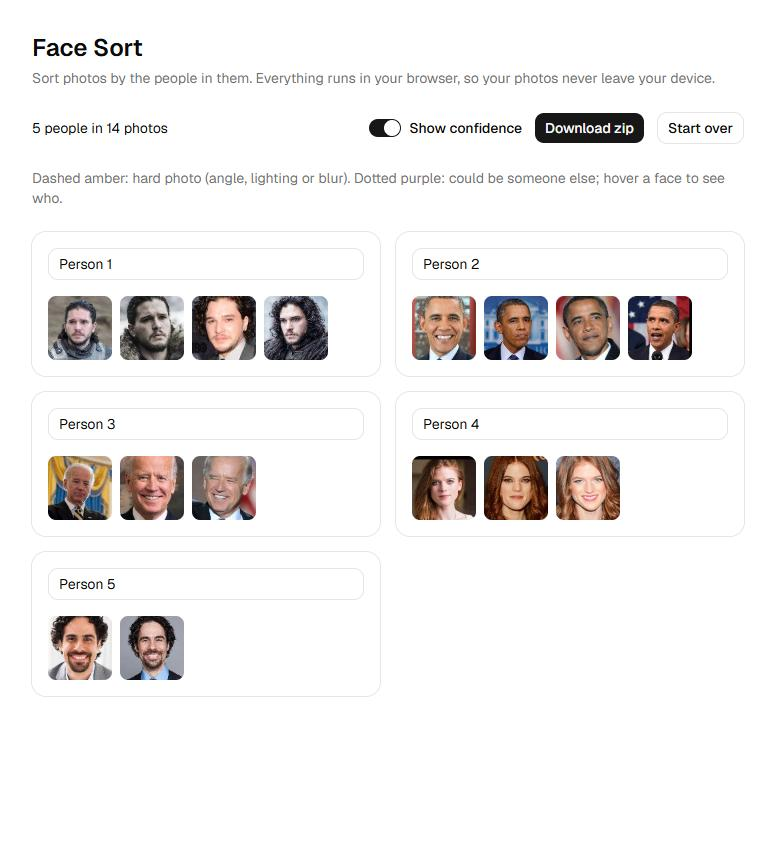

# Face Sort

Sort a pile of photos by the people in them, entirely in your browser. Nothing is uploaded: face detection, recognition and grouping all run on your device, and the result downloads as a zip with one folder per person.



## Features

- Pick or drag-and-drop photos, with a progress bar while faces are found
- One card per person; rename people, and click any face to see it in its original photo
- **Download zip**: a folder per person (a group photo goes into every person's folder), plus `Unsorted` for photos without a recognisable face
- Choose the recognition model: **SFace** (default, Apache-2.0) or **MBF** (smaller and slightly more accurate, non-commercial licence)
- Optional **Show confidence**: marks faces that were hard to match (unusual angle, lighting or blur) and faces that could belong to another person
- No backend, no account, no tracking; the app is a static site

## How it works

1. **Find faces.** [Human](https://github.com/vladmandic/human) detects each face and its 468-point landmark mesh. Blurry, tiny or strongly turned faces are skipped.
2. **Align.** Five landmarks (eyes, nose tip, mouth corners) are used to rotate and scale each face onto the standard 112×112 ArcFace layout.
3. **Recognise.** An ArcFace-family model ([SFace](https://github.com/opencv/opencv_zoo/tree/main/models/face_recognition_sface) or InsightFace's MBF) runs through [ONNX Runtime Web](https://onnxruntime.ai/) (WebGPU, with a WebAssembly fallback) and turns every face into an embedding (128 numbers for SFace, 512 for MBF).
4. **Group.** Faces are compared by cosine similarity and grouped with average-linkage clustering (threshold 0.42 for SFace, 0.30 for MBF). Two faces from the same photo are never put in the same group.

## Accuracy

Measured on the [LFW](https://vis-www.cs.umass.edu/lfw/) dataset (5 photos per person plus one-photo decoys), scored as pairwise F1 on people held out from tuning:

| People | Human's built-in model | SFace | MBF |
|---|---|---|---|
| 100 | 0.883 | **0.996** | **0.996** |
| 200 | 0.859 | **0.985** | **0.987** |
| 423 (2,754 faces) | 0.819 | **0.984** | **0.989** |

At 423 people SFace made 4 wrong-merge pairs and MBF 1, against 197 for Human's built-in model. LFW is mostly front-facing photos of public figures; event photos with side faces and motion blur are harder.

## Getting started

```bash
npm install
npm run dev
```

Open http://localhost:3000. Other scripts:

- `npm run build`: static export to `out/`, ready for any static host (Vercel, GitHub Pages, Cloudflare Pages…)
- `npm test`: unit tests for the grouping maths (`node --test`, no extra tooling)

The first visit downloads about 67 MB with SFace (model 39 MB, the ONNX Runtime WebAssembly engine 27 MB, Human's face models about 2 MB), or about 43 MB with MBF (14 MB model). Browsers cache them afterwards.

## Limitations

- Processing runs on the main thread, so the page can feel busy during large batches.
- Grouping slows down past roughly 2,000 faces.
- A modern browser with WebGPU (Chrome, Edge) is fastest; others fall back to WebAssembly.

## Tech stack

Next.js 16 (static export) · React 19 · Tailwind CSS 4 · shadcn/ui · Human · ONNX Runtime Web · fflate

## Legacy version

The original version, a Next.js frontend talking to a Python [FastAPI backend](https://github.com/Rohan1279/fast-api-face-recognition) built on `face_recognition`, is kept at `/legacy`. It needs that backend running locally on port 7000.

## Credits

- [Human](https://github.com/vladmandic/human) by Vladimir Mandic (MIT): face detection and landmarks
- [SFace](https://github.com/opencv/opencv_zoo/tree/main/models/face_recognition_sface) from the OpenCV Zoo (Apache-2.0): default face recognition model
- MBF (`w600k_mbf`) from [InsightFace](https://github.com/deepinsight/insightface)'s `buffalo_s` pack: optional face recognition model. The pretrained weights are licensed for **non-commercial research use only**.
- [ONNX Runtime Web](https://github.com/microsoft/onnxruntime) (MIT)
- [fflate](https://github.com/101arrowz/fflate) (MIT): zip export
- [shadcn/ui](https://ui.shadcn.com) (MIT): UI components
- Labeled Faces in the Wild: G. B. Huang, M. Ramesh, T. Berg, E. Learned-Miller, *Labeled Faces in the Wild: A Database for Studying Face Recognition in Unconstrained Environments*, UMass Amherst, 2007
